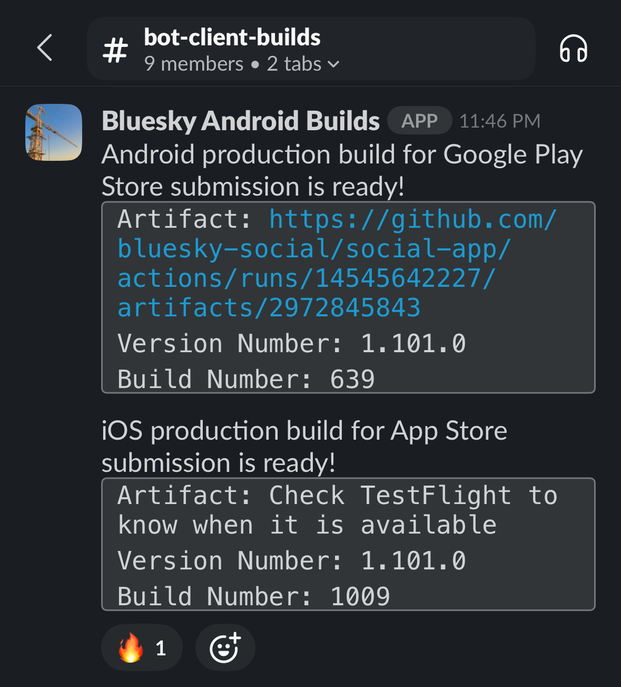
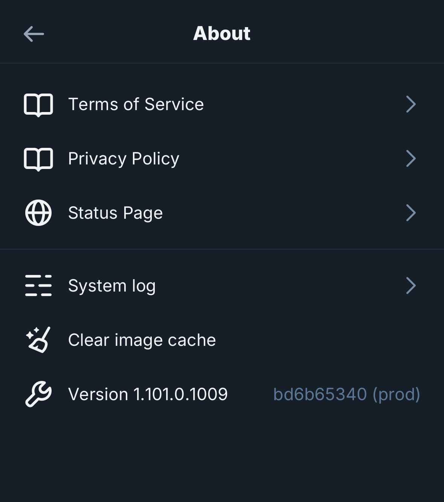
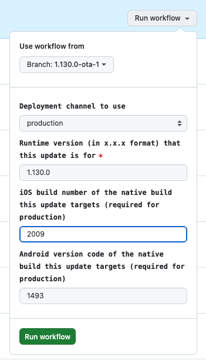
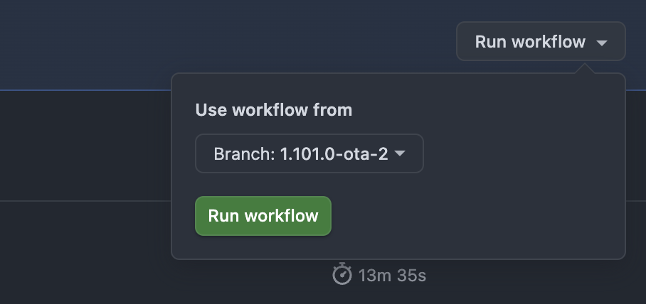
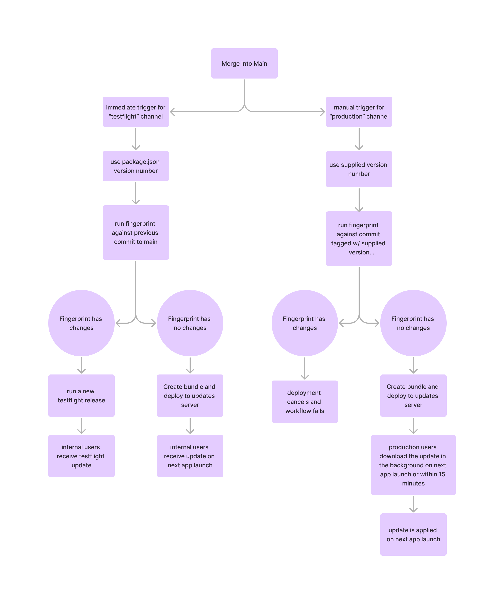

# OTA Deployments

## Automatic internal OTAs

OTA deployments to TestFlight/APK installs happen automatically upon all merges
into main. In cases where the fingerprint diff shows incompatible native
changes, a new client build will automatically be ran and deployed to TestFlight
(iOS) or delivered in Slack (Android).

## Production OTAs

Production OTAs can only update the JavaScript bundle. Changes to native modules
must be done as a full release cycle through the app stores.

Every release has a `release-x.y.z` branch, created when the release is cut.
Production OTAs are deployed from that branch: changes land on it through a PR,
and the deploy workflows run against it. That way the release branch always
matches what's live in production.

> [!TIP]
> If you're using a TestFlight build, in order to reference the correct build
> number and to verify the success of an OTA, you will need to delete the
> TestFlight app itself, delete the Bluesky app entirely, and re-install from
> the App Store.

### 1. Find the build numbers

Find the iOS build number and Android version code of the production builds.
The quickest place to look is the summary of the latest successful [Build and
Submit
iOS](https://github.com/bluesky-social/social-app/actions/workflows/build-submit-ios.yml)
and [Build and Submit
Android](https://github.com/bluesky-social/social-app/actions/workflows/build-submit-android.yml)
runs on the `release-x.y.z` branch, under "iOS build number" and "Android build
number". They're also posted to `#bot-client-builds` after each release, and
shown under the `About` section in app settings.

If a platform was rebuilt during the release, check which build was actually
submitted to the store. An OTA only reaches the exact build it targets.

| Slack | In app |
| ----- | ------ |
|  |  |

### 2. Ensure the release is tagged

You need to ensure that the release was properly tagged using the format
`x.y.z`. The OTA workflow fingerprints the release branch against this tag, and
aborts if anything native has changed since. If the tag is missing, the
deployment will simply fail since the GitHub Action will not be able to find a
commit to fingerprint and diff against.

### 3. Create a branch off the release branch

Create a branch off `release-x.y.z`. The name doesn't matter much since the PR
is squash-merged, but something like `yourname/release-x.y.z-ota-1` keeps it
easy to find. Double check that the `version` in `package.json` is `x.y.z`.

Then cherry-pick the commits that need to be deployed, in the order they landed
on `main`:

```sh
git fetch origin
git switch -c yourname/release-x.y.z-ota-1 origin/release-x.y.z --no-track
git cherry-pick <sha> <sha> ...
```

### 4. Pull translations

Since translators may have added new strings, and positions within the code may
have shifted, it's typically best to pull the latest translations. This needs a
Crowdin personal access token, which you can create under Account Settings > API
in Crowdin.

Run this and commit the result as the last commit on the branch.

```sh
CROWDIN_PERSONAL_TOKEN=<token> pnpm intl:release
git add src/locale
git commit -m "intl:release"
```

### 5. Merge into the release branch

Open a PR into `release-x.y.z` titled `Release x.y.z OTA N`, where `N` is one
more than the number of OTA PRs already merged into that release branch. Once CI
passes, squash-merge it, so each OTA shows up as a single commit on the release
branch.

### 6. Run the GitHub actions

You'll need to run two separate actions: one to deploy the iOS/Android OTA
itself, and one to build the web Docker container. Run both from the
`release-x.y.z` branch, not from your PR branch.

**For the iOS/Android OTA,** head to [Actions > Bundle and Deploy EAS
Update](https://github.com/bluesky-social/social-app/actions/workflows/bundle-deploy-eas-update.yml)
and run the action.

| Steps |     |
| ----- | --- |
| Select the `release-x.y.z` branch, select `production` in the dropdown, enter the git tag of the release `x.y.z`, enter the iOS build number and Android version code you found in **Step 1**, and click "Run workflow"  |  |

> [!NOTE]
> Production OTAs are bound to the specific native build they target, so the
> workflow requires the build numbers to be entered manually. There is no need
> to change the global EAS build counters (and doing so is no longer necessary
> for OTAs - they are only used when producing new native builds).

> [!NOTE]
> If you do enter an incorrect version here, the deployment will either:
> - Fail, because the action cannot find a commit with your misentered version
> - Succeed, but with no users receiving the update. This is because the
>   version and build numbers you entered will not match any clients in the
>   wild, so none will be able to receive the update.

**For web,** head to [Actions >
build-and-push-bskyweb-aws](https://github.com/bluesky-social/social-app/actions/workflows/build-and-push-bskyweb-aws.yaml)
and run the action.

| Steps |     |
| ----- | --- |
| Select the `release-x.y.z` branch, leave `sourceRef` empty to build the tip of the branch, and click "Run workflow" |  |

### 7. Deploy web

Once the web Docker container build finishes, copy the most recent commit hash
on `release-x.y.z`. Post this hash in `#ops-deploys` and request someone with
web deploy access deploy the built container.

### 8. Confirm successful deployment

In about five minutes, the new deployment should be deployed and devices will
begin downloading and installing in the background.

To confirm this, as mentioned above, you must completely clear the TestFlight
build from your device and re-install from the App Store. Then, you'll need to:
- Launch the app (or quit and reopen) and wait ~15s for the download to complete
- Quit and reopen the app
- Check the `Settings > About` page and confirm the hash matches the most recent hash on `release-x.y.z`

## Overview diagram


