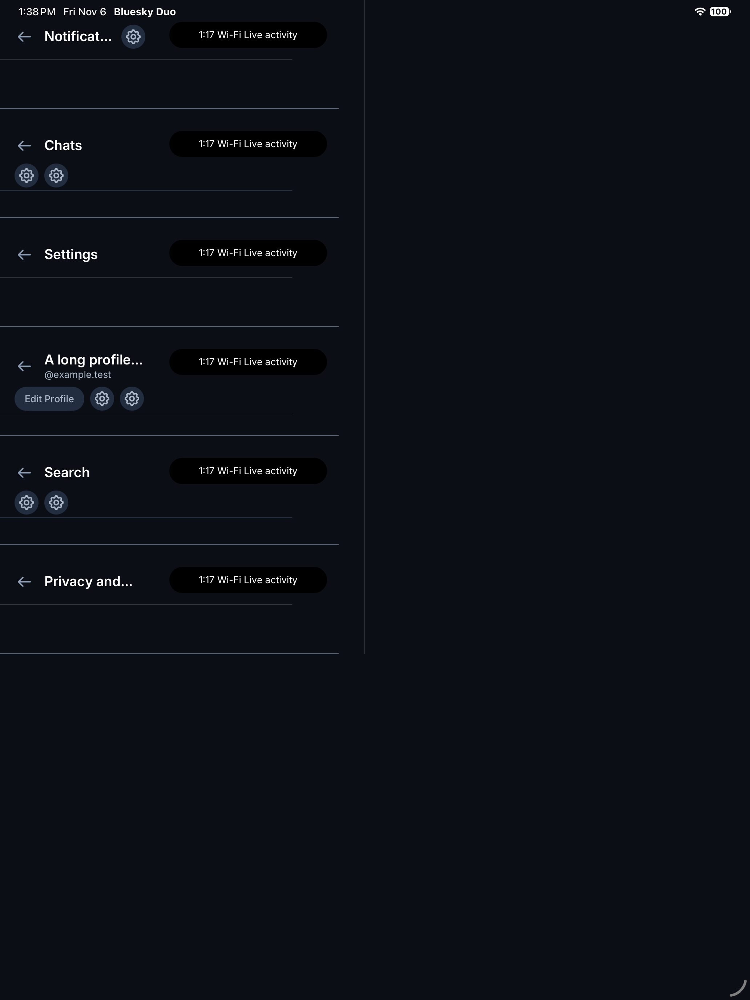

# iPhone Duo layout reference

This draft captures React Native layout work from a personal source build used on
a physical iPhone Duo. It is offered as implementation reference for maintainers
and their coding agents working on Duo support. It is not a request to merge the
viewport heuristic or measured status exclusion unchanged.

Related upstream work: [#12264](https://github.com/bluesky-social/social-app/pull/12264)
(status-bar migration and Duo inset handling), including its references to
APP-3694, APP-3685, APP-3686, APP-3687, and APP-3688. This reference builds on that
work; it does not change the status-bar behavior introduced there.

## Result

- On the folded outer display, the existing Home, Search, Chats, Notifications,
  and Profile controls run down the right edge. Compose sits below Profile.
- The content reserves the rail width instead of drawing underneath it. The
  original floating post-compose control is suppressed while that rail is active.
- In portrait, navigation headers can share vertical space with the trailing
  status cluster instead of stacking a full toolbar below its inset. Long shared
  header titles truncate; crowded action groups can wrap within the available
  area.
- Shared headers and custom Home, Notifications, conversation, profile, video,
  and lightbox headers use the same compact geometry helper. Home scroll offsets
  follow the reduced header height.
- Signed-out, onboarding, queued-signup, and video-feed surfaces exclude the rail.
  Dialog and split-view shared headers exclude the compact adjustment. Wider
  layouts retain the existing tablet navigation selection.

## Opt-in and limitations

The experiment is **off by default**. Explicitly set
`EXPO_PUBLIC_DUO_FOLDED_RIGHT_NAV=1` for a test build, following the repository's
normal local build setup. No provisioning, signing, bundle-ID, branding, native
SwiftUI, or dependency changes are included here.

The flag is a build-time experiment switch, not device detection. Once enabled,
`isDuoFoldedDisplay` selects iOS screens whose largest logical dimension is below
the existing mobile breakpoint. That also matches other compact iPhones. It must
not be enabled generally without a supported device/posture or capability check.
Screen rather than window dimensions keep the selection stable when the keyboard
opens, but other windowing modes need review.

The rail is 64 logical points wide, plus the trailing safe inset. The portrait
header uses a 48-point row and reserves `min(250, width * 0.54)` points at the
trailing screen edge. These values came from observed outer-display layouts,
including an active call/live activity shifting the clock left. They do not
guarantee coverage of every status presentation, localization, accessibility
size, or OS version. A production version should derive exclusions from platform
information where available and have an explicit fallback. Landscape keeps the
ordinary header geometry.

The observed outer viewport was 466 x 678 logical points. The observed unfolded
rendered viewport was approximately 951 x 669. These are test observations, not
device-identification constants or a claim about native panel resolution.

## Code map for review or adaptation

| Entry point | Responsibility |
| --- | --- |
| `src/view/shell/duoFoldedNavigation.ts` | Opt-in selection, rail context, compact-header geometry |
| `src/Navigation.tsx` and `nativeTabBarVisibility.ts` | Route eligibility, rail width, content reservation, footer height |
| `src/view/shell/bottom-bar/` | Reuses the existing tab controls vertically; adds Compose with the original composer hook and profile mention behavior |
| `src/view/com/util/fab/FAB.tsx` | Suppresses the duplicate post-compose FAB while the rail is active |
| `src/components/Layout/` | Shared compact screen/header spacing, title truncation, action wrapping |
| `src/components/hooks/useHeaderOffset.ts` and `HomeHeaderLayoutMobile.tsx` | Matching Home header and feed scroll offsets |
| Notifications, Messages, Profile, VideoFeed, Lightbox header changes | Custom-header consumers outside the shared default path |
| `src/view/shell/__fixtures__/headerEntry.ios.tsx` | Separate synthetic shared-header entry point, with no sessions or network clients |

The fixture is not imported by the application entry point. Run it as a separate
iOS entry file in a local simulator build. It uses a fixed 466-point column,
synthetic insets, and a painted status exclusion to inspect real shared header
components with long titles and crowded buttons. The attached capture was made
in an iPad simulator; it is **not** a screenshot of the physical Duo or a full
device simulator. Its mock status area is illustrative.



## Validation and its limits

The UI changes were extracted from a personal build based on upstream
`1ff197301c153d7ced43ea7ed66bee311f5e6bb5` (app version 1.138.0). That build was
compiled with Xcode 27.1 and installed on a physical Duo running iOS 27.2.

- The owner confirmed the right-side navigation and integrated Compose layout on
  the device, then confirmed the compact Post and Home header iterations.
- A physical screenshot with an expanded status capsule exposed a header action
  overlap. The trailing exclusion was increased in the later iteration.
- The final personal build, 3011, was successfully installed. Long-title and
  crowded-action cases using the final shared header code were visually checked
  with the synthetic simulator fixture shown above.
- The personal Release build and signature/package checks passed. The production
  bundle did not contain the fixture screen.

There was no exhaustive final physical-device pass through every changed header.
In particular, the final DM, profile, notifications, video, and lightbox changes
should receive route-by-route device QA. Simulator layout checks do not establish
physical status-bar correctness. Full accessibility, localization, rotation,
fold/unfold transitions, account switching, composer interactions, and other
platform regression coverage remain upstream integration work.

This clean reference branch excludes the personal native project and signing
setup; it is not itself claimed to have been signed and installed on the device.
The checks to run here are:

```sh
pnpm test:duo-layout
pnpm typecheck:ios
pnpm lint:duo-layout
```

The focused suite covers display geometry, navigation visibility exclusions, and
the existing iOS composer sheet behavior. It does not exercise live API writes or
establish threading/DM feature parity. Formatting is available through
`pnpm format:duo-layout`.

Prepared with Codex assistance. The implementation and evidence are offered for
discussion and selective adaptation to the upstream Duo design.
